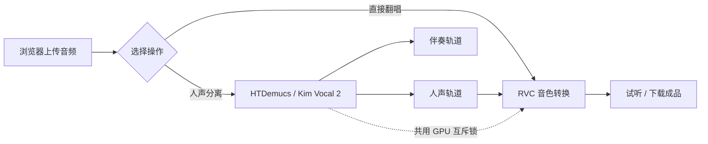

<div align="center">

# VoiceCover

**本地 AI 翻唱工具 —— 人声分离 + RVC 音色转换，一个网页完成**

[](#环境要求)
[](#技术栈)
[](#技术栈)
[](#技术栈)
[](#项目特点)
[](#许可证)

上传歌曲 → 分离人声与伴奏 → 选择音色 → 生成翻唱成品。  
全程在本机 GPU 上运行，不上传云端、不调用任何在线 API。

</div>

---

## 目录

- [项目特点](#项目特点)
- [工作流程](#工作流程)
- [技术栈](#技术栈)
- [项目结构](#项目结构)
- [环境要求](#环境要求)
- [安装](#安装)
- [模型准备](#模型准备)
- [使用说明](#使用说明)
- [配置说明](#配置说明)
- [HTTP 接口](#http-接口)
- [常见问题](#常见问题)
- [已知限制](#已知限制)
- [致谢](#致谢)
- [许可证](#许可证)

---

## 项目特点

- **人声分离**：内置两种模型
  - `HTDemucs` —— Demucs 四轨分离，取人声轨，其余三轨（鼓、贝斯、其他）叠加为伴奏；
  - `Kim Vocal 2` —— Mel-Band-RoFormer（`audio-separator` 加载），分离质量更好，为默认模型。
- **音色转换**：基于 [RVC v2](https://github.com/RVC-Project/Retrieval-based-Voice-Conversion-WebUI)，支持任意 RVC `.pth` 音色模型。
- **两种翻唱音源**：可以直接用原始歌曲，也可以使用上一步分离出的人声。
- **音调调节**：`-12 ~ +12` 半音，内置「女变男 -8」「男变女 +8」「还原 0」快捷预设。
- **输出格式**：翻唱支持 WAV / MP3；分离结果支持 WAV / MP3 / FLAC。
- **GPU 互斥**：分离与翻唱共用一个全局 GPU 锁，同一时刻只有一个模型占用显存，避免 OOM。
- **任务管理**：后台线程执行 + 前端 2 秒轮询进度；翻唱任务支持中途取消。
- **文件管理**：设置页统一查看 / 单删 / 批量删除上传音频、分离结果和翻唱成品。
- **自动清理**：成品保留 7 天，上传与分离文件保留 1 天。
- **路径安全**：所有文件读写 / 删除都限制在 `uploads`、`separated`、`outputs` 三个目录内，防止目录穿越。

> **纯本地、离线**：只有首次下载 Demucs 模型权重时需要联网，推理和转换过程不产生任何网络请求。

## 工作流程



一次完整的翻唱包含两个阶段：

1. **分离**：`ffmpeg`/`soundfile` 读入音频 → Demucs 或 Mel-Band-RoFormer 推理 → 输出人声与伴奏；
2. **翻唱**：`ffmpeg` 转 16 kHz 单声道 → 子进程运行 RVC 推理（Harvest 提取音高、检索索引）→ 按需转 MP3 → 输出成品。

两个阶段可以在网页上连续完成，中间结果还能单独试听和下载。

## 技术栈

| 模块 | 技术 | 说明 |
|---|---|---|
| Web 框架 | **Flask 3** | 单文件后端 [voicecover/app.py](voicecover/app.py)，默认监听 `0.0.0.0:5000` |
| 前端 | **Jinja2 + 原生 JS/CSS** | 无前端框架；音色卡片服务端渲染，前端负责分页、搜索、拖拽上传、进度轮询 |
| 音色转换 | **RVC v2**（VITS） | 完整 RVC-Project WebUI 代码位于 [RVC/](RVC/)，通过 `tools/infer_cli.py` 以子进程调用 |
| 人声分离 | **Demucs / audio-separator** | `htdemucs` 与 Mel-Band-RoFormer（Kim Vocal 2） |
| 深度学习 | **PyTorch + CUDA** | 作者环境：`torch 2.11.0+cu128` |
| 音频处理 | **ffmpeg** | 预处理、格式转换；需在系统 PATH 中 |
| 模型下载 | **HuggingFace 镜像** | 通过 `hf-mirror.com` 拉取，缓存到 `voicecover/models/hub` |
| 任务模型 | **线程 + 内存字典 + 轮询** | 无 Redis / Celery，单用户本地工具定位 |

**已验证的核心依赖版本**（Python 3.10.11）：

| 包 | 版本 |
|---|---|
| Flask / flask-cors | 3.1.3 / 6.0.5 |
| torch / torchaudio | 2.11.0+cu128 |
| demucs | 4.1.0 |
| audio-separator | 0.44.3 |
| numpy / scipy / librosa | 2.2.6 / 1.15.3 / 0.11.0 |
| soundfile | 0.14.0 |
| fairseq / faiss-cpu | 0.12.2 / 1.14.3 |

## 项目结构

```
.
├── README.md                  # 本文件
├── voicecover/                # Web 应用
│   ├── app.py                 # Flask 路由：上传 / 分离 / 翻唱 / 下载 / 取消 / 文件管理
│   ├── config.py              # 所有路径集中配置
│   ├── tasks.py               # 翻唱任务线程、子进程管理与取消
│   ├── separation.py          # 分离任务、两种分离模型、GPU 互斥锁
│   ├── utils.py               # ffmpeg 预处理、音色扫描、文件清理、显示名映射
│   ├── templates/             # index.html（主流程）、settings.html（文件管理）
│   ├── static/
│   │   ├── css/               # 页面样式
│   │   ├── js/                # main.js（主流程）、settings.js（文件管理）
│   │   └── uploads/           # 上传的原始音频（不入库）
│   ├── outputs/               # 翻唱成品（不入库）
│   ├── separated/             # 分离结果（不入库）
│   ├── models/                # Kim Vocal 2 权重与 HF 缓存（不入库）
│   ├── requirements.txt       # Python 依赖
│   ├── run.sh / start.bat     # 启动脚本
│   └── venv/                  # 虚拟环境（不入库）
└── RVC/                       # RVC-Project WebUI 代码
    ├── tools/infer_cli.py     # 本项目的推理命令行入口
    ├── run_infer.py           # torch 2.6+ 兼容补丁 + 启动推理
    └── assets/
        ├── weights/           # 音色 .pth（不入库）
        ├── indices/           # 音色检索索引 .index（不入库）
        ├── hubert/            # RVC 底模（不入库）
        ├── rmvpe/             # 音高提取模型（不入库）
        └── pretrained_v2/     # 生成器底模（不入库）
```

> 模型文件体积较大，仓库**只包含代码**。首次使用需按下方[模型准备](#模型准备)放置模型。

## 环境要求

| 项目 | 要求 |
|---|---|
| 操作系统 | Windows 10 / 11（提供的 `start.bat` 为 Windows 脚本） |
| GPU | NVIDIA 显卡，支持 CUDA；CPU 也能跑，但速度很慢 |
| Python | 3.10（作者环境 3.10.11；RVC 代码兼容 3.8 ~ 3.11） |
| 显存 | 建议 6 GB 以上；分离与翻唱会串行使用显存 |
| ffmpeg | 需要加入系统 PATH（`ffmpeg -version` 能直接运行） |
| 磁盘 | 预留数 GB 存放 RVC 底模、分离模型和音色模型 |

## 安装

### 1. 克隆仓库

```bash
git clone https://github.com/guanxing-spec/voicecover.git
cd voicecover
```

### 2. 创建虚拟环境

> 注意：虚拟环境必须放在 `voicecover/venv`，因为 `config.py` 会从该路径调用 Python 运行 RVC 推理。

```bat
cd voicecover
py -3.10 -m venv venv
venv\Scripts\activate
```

### 3. 安装依赖

先安装与你的 CUDA 版本匹配的 PyTorch（示例为 CUDA 12.8）：

```bash
pip install torch torchaudio --index-url https://download.pytorch.org/whl/cu128
pip install -r requirements.txt
```

`requirements.txt` 覆盖 Web 服务、人声分离和 RVC 推理所需的主要依赖。  
如果安装 RVC 官方 `RVC/requirements.txt` 时出现版本冲突，**以本项目的 `requirements.txt` 为准**——官方清单固定了较旧的 `numpy` / `librosa` / `gradio`，与本项目的 Demucs / audio-separator 不兼容，且 WebUI 界面相关依赖在本项目中并不需要。

> 若 `fairseq` 安装失败，先确认已安装 Cython，再执行 `pip install fairseq==0.12.2 --no-build-isolation` 重试。

### 4. 启动

方式一（Windows 推荐）：双击 `voicecover\start.bat`，会自动启动服务并打开浏览器。

方式二（手动）：

```bash
cd voicecover
venv\Scripts\python app.py
```

然后在浏览器打开 <http://localhost:5000>。

## 模型准备

仓库不包含任何模型权重，请按以下路径放置：

| 用途 | 文件 | 放置位置 |
|---|---|---|
| RVC 音色 | `<音色名>.pth` | `RVC/assets/weights/` |
| 音色检索索引（可选，提升相似度） | `<音色名>.index` | `RVC/assets/indices/` 或 `RVC/logs/<音色名>/<音色名>.index` |
| RVC 底模 | `hubert`、`rmvpe`、`pretrained_v2` 下的权重 | `RVC/assets/` 对应目录 |
| Kim Vocal 2 | `vocals_mel_band_roformer.ckpt` 与同名 `.yaml` | `voicecover/models/weights/` |
| HTDemucs | 首次分离时自动下载 | `voicecover/models/hub/`（自动） |

补充说明：

- RVC 底模可从官方 HuggingFace 仓库 `lj1995/VoiceConversionWebUI` 获取；国内网络建议使用 `hf-mirror.com` 镜像。
- 有 `.index` 的音色在音色卡片上会显示「高清」角标，检索索引能显著提升音色相似度。
- 音色显示名在 [voicecover/utils.py](voicecover/utils.py) 的 `VOICE_NAME_MAP` 中维护；未登记的音色直接显示文件名。
- 添加或删除 `.pth` 后刷新首页即可看到最新音色列表。

## 使用说明

1. **上传歌曲**：在首页拖拽或点击上传 MP3 / WAV / FLAC / M4A（前端限制 50 MB）。
2. **人声分离**（可选）：选择分离模型与输出格式，点击「分离人声与伴奏」；完成后可分别试听和下载人声、伴奏。
3. **选择音源**：在「配音翻唱」区域选择「本地音频」或「分离后人声」。
4. **选择音色**：点击音色卡片选中，可翻页或按名称搜索。
5. **调音调**：拖动音调滑块或使用快捷预设。
6. **开始翻唱**：点击「开始翻唱」，页面轮询进度；完成后可试听或下载成品，中途可点击「取消转换」。
7. **管理文件**：进入「设置」页，查看并删除上传音频、分离结果和翻唱成品。

## 配置说明

所有路径集中在 [voicecover/config.py](voicecover/config.py)：

| 配置项 | 默认值 | 说明 |
|---|---|---|
| `RVC_DIR` | `../RVC` | RVC 目录，可用环境变量 `RVC_DIR` 覆盖 |
| `VENV_PYTHON` | `voicecover/venv/Scripts/python.exe` | 运行 RVC 推理的 Python |
| `UPLOAD_DIR` | `voicecover/static/uploads` | 上传的原始音频 |
| `OUTPUT_DIR` | `voicecover/outputs` | 翻唱成品 |
| `SEPARATION_DIR` | `voicecover/separated` | 分离结果 |
| `MODELS_DIR` | `voicecover/models` | 分离模型与 HuggingFace 缓存 |

其他运行参数（见 [tasks.py](voicecover/tasks.py)、[separation.py](voicecover/separation.py)、[utils.py](voicecover/utils.py)）：

| 参数 | 值 | 说明 |
|---|---|---|
| 服务端口 | `5000` | `app.run(..., port=5000)` |
| GPU 锁等待 | 300 秒 | 超时后任务报错，可重试 |
| RVC 推理超时 | 1800 秒 | 子进程超时会被终止 |
| 前端轮询间隔 | 2 秒 | 分离与翻唱进度 |
| 文件保留 | 成品 7 天 / 上传 1 天 / 分离 1 天 | 任务完成后自动清理 |
| RVC 推理参数 | Harvest、`index_rate=0.66`、`filter_radius=3` | 见 `tasks.py`，可按需调整 |

## HTTP 接口

| 方法 | 路径 | 说明 |
|---|---|---|
| GET | `/` | 首页 |
| GET | `/settings` | 设置（文件管理）页 |
| POST | `/upload` | 上传音频，返回 `file_path` 与访问 URL |
| GET | `/models` | 音色列表 |
| POST | `/separate` | 启动分离任务，返回 `task_id` |
| GET | `/separation-status/<id>` | 分离任务状态 |
| GET | `/separation-download/<id>/<vocal\|inst>` | 试听 / 下载分离结果 |
| POST | `/convert` | 启动翻唱任务，返回 `task_id` |
| GET | `/status/<id>` | 翻唱任务状态 |
| GET | `/download/<id>` | 试听 / 下载翻唱成品 |
| POST | `/cancel/<id>` | 取消翻唱任务 |
| GET | `/api/files` | 列出三类目录中的文件 |
| POST | `/api/files/delete` | 批量删除文件（仅限白名单目录） |
| POST | `/cleanup` | 立即清理上传与成品目录 |

## 常见问题

**Q：一直停留在「等待 GPU 资源中…」？**  
分离和翻唱共用一把 GPU 锁。如果另一个任务正在跑，后提交的任务会排队；等待超过 5 分钟会失败，稍后重试即可。

**Q：提示显存不足 / OOM？**  
先确认没有别的程序占用显存；本项目内部靠互斥锁保证不并发，但外部程序（游戏、其他 AI 工具）仍可能抢占。

**Q：重启服务后任务列表空了？**  
任务状态保存在内存字典中，重启即丢失。已完成文件仍保留在 `outputs/` 等目录。

**Q：分离按钮是灰的 / 音色列表为空？**  
分离需要先上传音频；音色列表来自扫描 `RVC/assets/weights/*.pth`，确认文件已放入并刷新页面。

**Q：翻唱报错找不到模型或索引？**  
确认 `.pth` 在 `RVC/assets/weights/`；`.index` 需与音色同名，放在 `RVC/assets/indices/` 或 `RVC/logs/<音色名>/`。

**Q：ffmpeg 相关报错（`FileNotFoundError` / 返回码非 0）？**  
安装 ffmpeg 并加入系统 PATH。`run.sh` 中额外写入了作者本机的 WinGet 路径，可按自己的环境修改或删除。

**Q：RVC 推理时报 `torch.load` 的 `weights_only` 错误？**  
PyTorch 2.6 起 `torch.load` 默认变为 `weights_only=True`。[RVC/run_infer.py](RVC/run_infer.py) 已内置兼容补丁，确认通过 `run_infer.py` 启动即可。

**Q：首次分离很慢？**  
首次使用 HTDemucs 需要联网下载模型权重，之后会走本地缓存。

## 已知限制

- 面向**单用户本地使用**：`app.run(debug=True)`、内存任务存储、单进程运行，不适合直接部署到公网或多用户环境。
- 只支持取消翻唱任务，**分离任务无法中途取消**。
- 上传大小限制只在前端校验，后端未强制。
- 分离完成后会顺带清理 7 天前的上传文件；不同任务路径的清理策略略有差异，详见 `tasks.py` 与 `separation.py`。
- `start.bat` 与 `run.sh` 面向 Windows 编写；Linux / macOS 需要自行调整路径和虚拟环境位置。
- 音色模型与翻唱作品涉及版权，请仅用于个人学习与合法授权场景。

## 致谢

本项目站在以下开源项目之上：

- [Retrieval-based-Voice-Conversion-WebUI](https://github.com/RVC-Project/Retrieval-based-Voice-Conversion-WebUI)（RVC，MIT）——音色转换引擎与底模；
- [Demucs](https://github.com/facebookresearch/demucs)（Meta）——四轨人声分离；
- [audio-separator](https://github.com/nomadkaraoke/python-audio-separator) 与 UVR 生态——Mel-Band-RoFormer 推理；
- Kim Vocal 2 / Mel-Band-RoFormer 模型作者——高质量人声分离模型；
- Flask、PyTorch 及所有依赖库的维护者。

第三方组件的许可证以其各自仓库为准。

## 许可证

本项目代码采用 [MIT License](LICENSE) 开源。  
RVC、Demucs、audio-separator 等第三方组件遵循其各自仓库的许可证；音色模型与分离模型的版权归原作者所有，使用前请自行确认授权范围。
